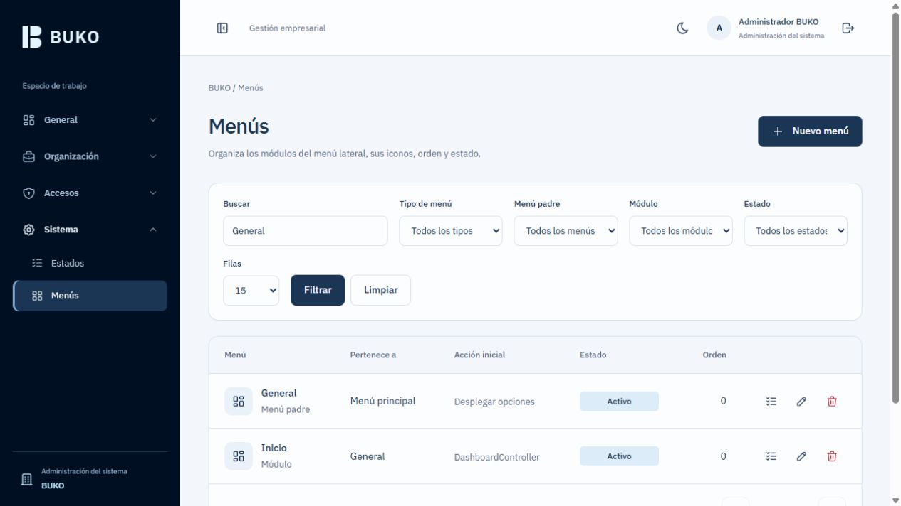
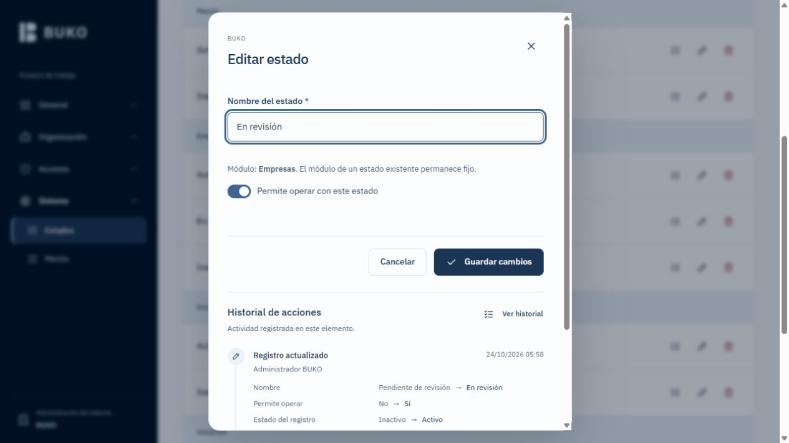
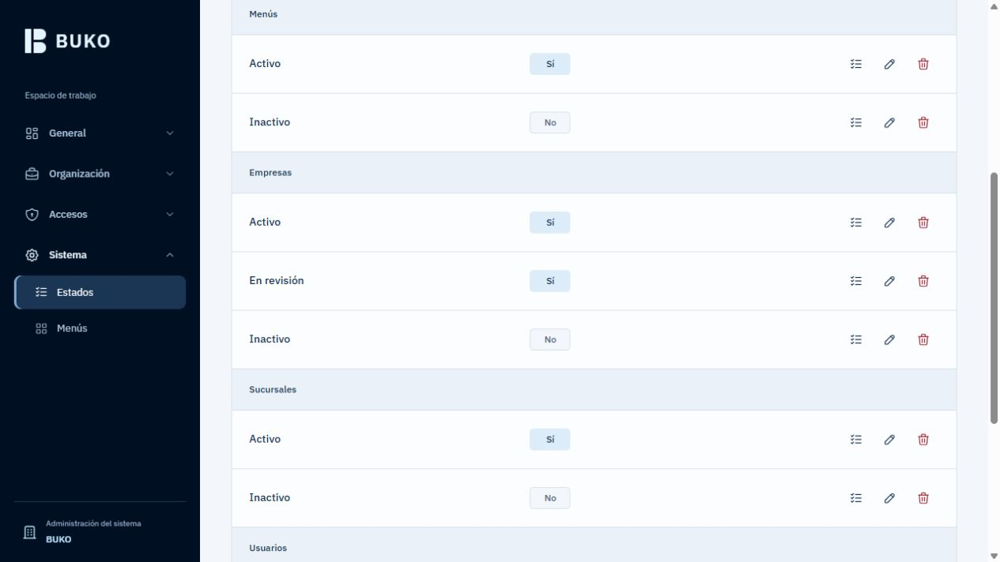
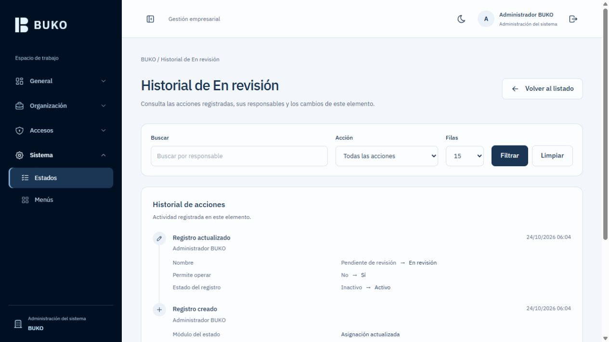

# BUKO · Gestión empresarial

BUKO es un sistema de gestión empresarial modular. Su base organiza empresas, sucursales, usuarios y accesos para incorporar nuevas funciones de negocio sin duplicar la lógica de autorización ni mezclar los datos de distintas empresas.

La aplicación utiliza Laravel y vistas Blade, con PostgreSQL como base de datos. Las páginas y formularios se renderizan en el servidor; cada módulo incluye su propio JavaScript para las interacciones que necesita. Las búsquedas y la paginación actualizan únicamente los resultados mediante `fetch`.

El alcance actual es la base administrativa y de seguridad. Nómina es una posible siguiente etapa; todavía no está implementada.

## Funcionalidades actuales

| Área | Funcionalidad |
| --- | --- |
| Autenticación | Login inicial con correo y contraseña, sesión, cierre de sesión y límite de intentos |
| Empresas | Información general, estado y habilitación de módulos por empresa |
| Sucursales | Sucursales asociadas a su empresa mediante `company_id` |
| Usuarios | Una empresa por usuario operativo, roles y permisos individuales |
| Roles y permisos | Roles por empresa y concesiones acumulativas, con límites de delegación |
| Estados | Catálogo agrupado por módulo/contexto; nombres editables y control de operación mediante `is_active` |
| Menús | Creación, edición y eliminación desde backoffice; padres, hijos, iconos, orden, acción inicial y estado |
| Procesos | Nombre del proceso y secuencia por empresa en una tabla de origen, destino, rol y estatus de resultado; gestión de etapas y reconexión automática |
| Compras | Proveedores por empresa, solicitudes en USD, etapas por rol, pendientes y tracking por participación personal |
| Historial y eliminación | Borrado lógico en los módulos administrativos; cronología con actor, fecha y cambios antes/después |
| Interfaz | Tema claro/oscuro, fuentes e iconos locales, modales accesibles y lateral adaptable a móvil |

Todos los listados incluyen buscador, filtros según su contenido, selector de filas y paginador con total. Búsquedas, filtros y cambios de página actualizan el contenido mediante `fetch`, manteniendo limpia la dirección del navegador.

Para editar un registro, haz clic en su nombre en el listado. Los formularios breves se abren en su modal y los amplios en su página de edición. Los registros protegidos no ofrecen enlace de edición.

Todas las filas comparten el mismo ancho y las mismas columnas. Los tres puntos se sitúan en la zona de etiquetas de la primera fila, en la esquina derecha, sin reducir el ancho de los campos. El acceso al historial está en ese menú y no se repite en el bloque de actividad reciente.

En los formularios de edición, el botón de tres puntos se alinea con la primera fila de campos en la esquina derecha del panel, también en modales, y abre **Ver historial**, **Imprimir detalle** y **Eliminar** cuando la operación está permitida. La última etiqueta reserva espacio para el botón, que queda por encima del control y no se superpone a él. Los listados no muestran iconos de historial ni papeleras; se accede al registro desde su nombre. La confirmación de eliminación se abre sobre la edición; al cancelar se conservan los cambios pendientes. La impresión incluye el detalle guardado y autorizado de cada registro, sin contraseñas ni cambios sin guardar. Las solicitudes de compra ofrecen historial e impresión de sus campos visibles y mantienen su flujo sin eliminación.

El superadministrador global no pertenece a una empresa y administra la configuración del sistema. Un administrador de empresa es un usuario con los permisos correspondientes; su rol no le concede acceso a otras empresas.

## Capturas

Las imágenes se guardan en [`docs/images`](docs/images) y se muestran mediante rutas relativas. No requieren alojamiento externo. Son capturas de las vistas Blade en el entorno local; las comprobaciones del historial utilizan datos de demostración aislados en SQLite en memoria.

### Administración de menús



<details>
<summary>Ver formulario breve en modal: edición de estado</summary>



</details>

<details>
<summary>Ver indicadores uniformes e historial de cambios</summary>





</details>

## Tecnologías

| Componente | Tecnología |
| --- | --- |
| Backend | PHP 8.2+ y Laravel 12 |
| Vistas | Blade y componentes Blade reutilizables |
| Base de datos | PostgreSQL 18 |
| Estilos | Tailwind CSS 4 y tokens de diseño propios |
| Interacción | JavaScript nativo, `fetch`, Web Animations API y `<dialog>` |
| Assets | Vite 7, entradas independientes por módulo |
| Tipografía | IBM Plex Sans autoalojada, pesos 400/500/600 |
| Iconografía | SVG locales de Tabler |
| Pruebas y formato | PHPUnit 11 y Laravel Pint |

La interfaz no depende de Vue, React ni de recursos servidos desde un CDN. Los controladores, Form Requests y servicios mantienen en Laravel las reglas de negocio y autorización.

## Ejecución local

El entorno de desarrollo utiliza Wamp y la URL:

```text
http://localhost/buko/public/
```

La raíz muestra el login; después de autenticarse se accede a `/inicio`. Se utilizan Apache y la configuración existente del equipo. Con los assets compilados no hace falta mantener `php artisan serve` ni un servidor Vite en ejecución.

Vite compila con base relativa `./`: las fuentes, imágenes e imports internos siguen la ubicación del CSS/JavaScript y funcionan bajo `/buko/public/`. No se requieren cambios de Wamp ni enlaces a `/build/` desde la raíz de `localhost`.

### Requisitos

- PHP 8.2+ con las extensiones requeridas por Laravel y `pdo_pgsql` activo en el PHP que atiende la web y en el de consola.
- PostgreSQL 18 y una base de datos creada para el proyecto.
- Composer 2.
- Node.js 22.12+ y npm para compilar los assets. La configuración de Vite utiliza `globSync` de Node.
- Permiso de escritura de la aplicación sobre `storage` y `bootstrap/cache`.

### Preparar una copia nueva

Estos pasos son para una instalación nueva; no sobrescribas el `.env` ni regeneres la clave de una instalación existente.

```powershell
composer install
Copy-Item .env.example .env
php artisan key:generate
npm ci
```

Configura tu conexión en `.env`. El ejemplo del repositorio utiliza el puerto local `5433`; conserva el que corresponda a tu PostgreSQL:

```dotenv
APP_NAME=BUKO
APP_URL=http://localhost/buko/public
APP_LOCALE=es
DB_CONNECTION=pgsql
DB_HOST=127.0.0.1
DB_PORT=5433
DB_DATABASE=buko
DB_USERNAME=postgres
DB_PASSWORD=
```

Las migraciones y los seeders se ejecutan manualmente:

```powershell
php artisan migrate
php artisan db:seed
npm run build
```

Las migraciones existentes son **inmutables**. Los cambios de esquema y las incorporaciones de catálogos para instalaciones existentes se entregan en migraciones nuevas e incrementales. No se utiliza `migrate:fresh` sobre la base de desarrollo.

Para preparar el entorno paso a paso se usan los comandos anteriores. El script heredado `composer run setup` ejecuta migraciones automáticamente y no corresponde al flujo manual del proyecto.

### Acceso inicial y configuración

El seeder crea los catálogos iniciales y el superadministrador a partir de `BUKO_ADMIN_NAME`, `BUKO_ADMIN_EMAIL` y `BUKO_ADMIN_PASSWORD`. Consulta los valores de desarrollo en [`.env.example`](.env.example). Repetir el seeder no restablece la contraseña de una cuenta existente; cambiar la variable de entorno tampoco actualiza una cuenta ya creada.

El desplegable de credenciales del login aparece únicamente con `APP_ENV=local` y `BUKO_SHOW_LOCAL_CREDENTIALS=true`. Las credenciales iniciales son para desarrollo. `.env` no se versiona.

La configuración inicial usa sesiones y caché en archivos, colas síncronas y correo mediante log. Redis y un trabajador de colas no son requisitos para esta etapa.

## Arquitectura y organización

Los controladores coordinan HTTP. Los Form Requests validan y autorizan las entradas. Los servicios concretos resuelven las operaciones de negocio y las transacciones. Eloquent representa los modelos y sus relaciones, sin capas de repositorios o interfaces añadidas por rutina.

```text
app/
  Http/
    Controllers/Auth/          Login y cierre de sesión
    Controllers/Management/    Controladores de los módulos administrativos
    Middleware/                Estado de cuenta y controles de acceso
    Requests/Management/       Validación y autorización de formularios
  Models/                      Entidades y relaciones por ID
  Services/
    Access/                    Permisos, delegación y aislamiento por empresa
    Auth/                      Autenticación
    Management/                Escrituras y transacciones por recurso
    Navigation/                Catálogo seguro y filtrado del menú
  Support/                     AsyncResponse y ListingResponse
resources/
  views/
    layouts/partials/          Head, header, navbar, topbar y footer
    components/                Campos, botones, estados, modales y vacíos
    modules/{modulo}/          Vistas y partials de cada módulo
  js/
    modules/{modulo}/          Entradas JavaScript independientes
    shared/                    Transporte, navegación, formularios y shell
  css/                         Tokens, estilos base y componentes compartidos
database/
  migrations/                  Evolución incremental del esquema
  seeders/                     Catálogos y cuenta inicial
tests/
  Feature/                     Contratos HTTP, seguridad y comportamiento
  Manual/                      Comprobaciones explícitas contra PostgreSQL local
```

### Relaciones y aislamiento

Todas las relaciones del dominio se almacenan mediante IDs con claves foráneas. Los nombres y códigos sirven para mostrar o localizar un registro, nunca para enlazar tablas.

| Relación | Implementación |
| --- | --- |
| Empresa → sucursales, usuarios y roles | `company_id` |
| Empresa ↔ módulos habilitados | Pivote `company_module`, con `company_id` y `module_id` |
| Usuario ↔ roles | Pivote `role_user`, con `user_id` y `role_id` |
| Rol ↔ permisos | Pivote `permission_role`, con `role_id` y `permission_id` |
| Usuario ↔ permisos directos | Pivote `permission_user`, con `user_id` y `permission_id` |
| Estado → tipo de estado | `status_type_id` |
| Entidad → estado | `status_id` |
| Menú → padre, módulo, permiso y estado | `parent_id`, `module_id`, `permission_id` y `status_id` |

El usuario operativo pertenece a una sola empresa. El superadministrador tiene `company_id = null`. No se trasladan usuarios ni roles entre empresas desde sus formularios de edición.

### Autorización

Se distinguen tres conceptos:

1. **Configuración del sistema:** permisos con `module_id` nulo, reservados al ámbito global.
2. **Módulos de empresa:** funciones habilitadas mediante `company_module`.
3. **Permisos del usuario:** concesiones directas y de roles pertenecientes a su misma empresa.

Para un usuario de empresa se exige cuenta activa, empresa activa, módulo habilitado y permiso concedido. Tener un rol o permiso directo no activa un módulo deshabilitado; habilitar el módulo tampoco concede por sí solo permisos a todos los usuarios.

Las rutas y las operaciones se autorizan en servidor, además de filtrar el menú. Las lecturas, escrituras y asignaciones de relaciones comprueban la empresa. Una cuenta no puede delegar permisos fuera de su alcance ni modificar una cuenta más privilegiada. `is_super_admin` no es asignable desde formularios.

Las revocaciones se aplican en la siguiente petición. Desactivar una empresa termina las sesiones de sus usuarios cuando vuelven a realizar una petición.

### Menú administrable

El menú es un catálogo global cuya visibilidad se filtra para cada usuario y empresa. Los padres agrupan opciones y no ejecutan acciones; los hijos pertenecen a un padre mediante `parent_id`.

El destino se elige del catálogo de rutas GET registradas en `NavigationRegistry`. El formulario muestra el controlador y su acción; el servidor deriva `module_id` y `permission_id`. No interpreta PHP, nombres de clases ni URLs arbitrarias guardados en la base.

Un padre con hijos no puede eliminarse ni convertirse en hoja hasta mover o eliminar sus hijos. Eliminar una entrada cambia la navegación y conserva los datos del módulo. Agregar un menú no implementa una nueva función de negocio: primero deben existir su código, ruta y permiso registrados.

## Vistas, navegación e interacción

- Las vistas se renderizan con Blade. Empresas, usuarios y roles tienen formularios amplios en páginas propias; estados, sucursales y menús se crean y editan en modales.
- Cada formulario modal está en la carpeta `partials/` de su módulo y se incluye en templates HTML locales. Blade renderiza la acción, el método y todos los valores del registro. JavaScript solo clona ese HTML en el modal, sin fetch al abrir ni hidratación de campos desde JSON. La confirmación de borrado sigue el mismo patrón.
- La navegación entre módulos y formularios largos es la normal de Laravel/Blade. No hay router de JavaScript, carga dinámica del shell, fade de página ni espera de salida antes de navegar.
- Cada vista interactiva declara su entrada mediante `@section('module', 'resources/js/modules/{modulo}/index.js')`; el layout incluye ese script directamente con Vite.
- El formulario de búsqueda y los enlaces del paginador se atienden mediante `fetch`. `ListingResponse` devuelve solo el fragmento Blade `list-results` al recibir `X-Buko-Listing: true`. Los filtros se aplican en servidor y los resultados cambian sin alterar la dirección ni el historial del navegador. Los enlaces GET quedan como alternativa sin JavaScript.
- Los datos editables se imprimen con el escape de Blade, también dentro de valores y atributos. Las URLs de acciones se generan mediante rutas del servidor. No se evalúan scripts ni se concatenan datos de usuario para construir formularios.
- Los modales conservan el foco, admiten Escape y muestran errores por campo. Los errores aparecen tras el primer blur o envío, con corrección posterior.
- Las microinteracciones son rápidas y discretas, respetan `prefers-reduced-motion` y no retrasan el uso del teclado.
- Los indicadores Sí/No comparten ancho y alto fijos; badges, paneles y acciones usan componentes y dimensiones comunes en todos los módulos.

## Borrado lógico e historial

Empresas, sucursales, usuarios, roles, estados y menús incluyen **Eliminar** con confirmación. Usan `SoftDeletes` y conservan el registro, sus IDs y relaciones. Los eliminados quedan fuera de los listados, opciones y autorización operativos. Un estado referenciado no se elimina; tampoco se permite eliminar la propia cuenta, el superadministrador o recursos fuera del alcance del actor.

El estado base se consulta mediante `lifecycle_status`: **1 activo, 0 inactivo, -1 eliminado**. Se deriva de `deleted_at` y de la disponibilidad del estado. `status_id` conserva su función de clave foránea; los futuros estados de facturación u otros procesos mantienen su comportamiento de negocio.

El historial registra creación, cambios y eliminación con actor, fecha y diferencias antes/después. Se guarda dentro de la misma transacción e incluye asignaciones de módulos, roles y permisos. No guarda contraseñas, hashes ni tokens; solo indica si se actualizó una contraseña. No se generan eventos para guardados sin cambios ni se inventa historial anterior.

Los formularios de edición muestran los últimos cambios. Cada fila ofrece acceso al historial completo, paginado y filtrable, y la confirmación tras guardar o eliminar incluye **Ver historial**. Su acceso respeta los permisos y la empresa, también para registros eliminados.

Para incorporar estas funciones en una instalación existente, ejecuta manualmente `php artisan migrate`. La migración incremental `2026_10_24_055321_add_soft_deletes_and_audit_entries.php` agrega `deleted_at` y `audit_entries`; las migraciones entregadas anteriormente permanecen intactas.

La paleta base es `#c0e6fd`, `#80aad3`, `#5b86b6`, `#3f6593`, `#1b3554` y `#000f22`. Los tokens se centralizan en `resources/css/app.css`; los componentes compartidos del espacio de trabajo, en `resources/css/components/workspace.css`.

## Contrato de respuestas asíncronas

Todas las llamadas `fetch` utilizan `resources/js/shared/http.js` y el mismo sobre:

```json
{
  "success": true,
  "message": "Cambios guardados correctamente.",
  "data": { "redirect": "http://localhost/buko/public/menus" },
  "errors": {},
  "meta": {}
}
```

Los fallos usan `success: false` y conservan su código HTTP: autenticación `401`, autorización `403`, registro inexistente `404`, sesión/CSRF `419`, validación `422`, límite de intentos `429` y error interno `500`. Los mensajes por campo se entregan en `errors`; los errores inesperados no exponen información interna.

El transporte comparte CSRF, `Accept: application/json` y credenciales del mismo origen. Los formularios evitan envíos duplicados y conservan sus valores ante errores de validación o red.

## Verificación

La suite automática usa SQLite en memoria, separada de PostgreSQL local. Incluye autenticación, aislamiento de empresas, escalamiento de privilegios, revocación de permisos y módulos, CRUD de menús, modales Blade, escape de datos y contrato de listados asíncronos.

```powershell
php vendor/phpunit/phpunit/phpunit
php vendor/bin/pint --test app/Http app/Models app/Services app/Support routes tests
npm run build
```

La comprobación manual de PostgreSQL está fuera de la suite automática. Solo debe ejecutarse de forma explícita contra la conexión local ya preparada; no migra, no ejecuta seeders y revierte sus datos de prueba mediante transacciones:

```powershell
php vendor/phpunit/phpunit/phpunit --no-configuration --bootstrap vendor/autoload.php tests/Manual/PostgresNavigationSmokeTest.php
```

No se debe ejecutar `RefreshDatabase`, `migrate:fresh` ni una reconstrucción de tablas contra la base local de trabajo.

## Continuar el desarrollo

Antes de crear o modificar un módulo, consulta [AGENTS.md](AGENTS.md). Allí se definen las reglas obligatorias de arquitectura, relaciones por ID, autorización, formularios, recursos locales, navegación, accesibilidad y verificación.

La [guía de la base de BUKO](docs/BASE_BUKO.md) amplía el modelo de datos, el flujo inicial de administración y las decisiones pendientes. Entre ellas están los permisos por operación, el alcance por sucursal y los flujos de perfil, recuperación y segundo factor. La auditoría inicial de cambios administrativos ya está implementada.

Las licencias de recursos autoalojados se conservan en [`public/licenses`](public/licenses): [IBM Plex Sans](public/licenses/IBM-Plex-Sans-OFL.txt) y [Tabler Icons](public/licenses/Tabler-Icons-MIT.txt).

### Procesos y etapas

La migración incremental `2026_10_26_000001_create_process_catalog.php` crea los pasos, las etapas, sus estados por contexto, las referencias de auditoría y la entrada **Sistema → Procesos**. Debe aplicarla el responsable del entorno con `php artisan migrate`; no requiere repetir seeders. No modifica migraciones anteriores ni asigna permisos a roles o usuarios existentes.

`system.processes.manage` es un permiso global: inicialmente solo accede el superadministrador; se puede delegar explícitamente a roles globales. Un usuario de empresa no obtiene acceso aunque reciba ese permiso. Desde **Gestionar etapas** se crean las etapas (nombre y estatus); después se registran los pasos con origen, destino, estatus y rol responsable. Los roles se distinguen por empresa o ámbito global, sin concederles acceso a Procesos por ser responsables. Origen y destino deben ser diferentes. El módulo Compras utiliza esta configuración para avanzar solicitudes; asignar un rol a una etapa no concede por sí solo permisos ni habilita el módulo.

Los formularios breves y sus confirmaciones usan modales Blade locales. Pasos y etapas conservan historial y borrado lógico. Una etapa referenciada por un paso vigente o eliminado no se elimina; puede desactivarse. Los roles eliminados y los de empresas eliminadas no se ofrecen para nuevas asignaciones; los pasos conservan sus referencias históricas. Los estados referenciados tampoco pueden eliminarse.

### Flujo operativo de compras

Compras incorpora **Pendientes**, **Tracking de solicitudes** y **Proveedores**. El monto utiliza USD y dos decimales. Se omite Desembolso: Solicitud de compra → Aprobación nivel 1 → Recepción y verificación → Pago. Las fechas se ingresan manualmente y no pueden preceder la fecha de la etapa anterior.

Todos consultan proveedor, monto y fechas. El comprador completa proveedor, fecha de compra y monto; el aprobador completa fecha de aprobación; el receptor completa fecha de recepción; el pagador completa fecha de pago. Guardar conserva la etapa; completar y enviar aplica su estatus de resultado y entrega al siguiente rol. Pago finaliza la solicitud. No se incluyen rechazos, devoluciones, cancelaciones ni pagos parciales.

La bandeja solo incluye pendientes del rol y la empresa del usuario. El tracking usa acciones auditadas de **ese usuario por ID**, no acciones de compañeros con el mismo rol. El acceso directo a formulario e historial aplica el mismo control. El módulo debe estar habilitado y el permiso `purchases.requests.work` concedido; los roles operativos no administran Procesos ni proveedores. El catálogo usa `purchases.suppliers.manage`.

La nueva migración `2026_10_26_000002_create_purchase_workflow.php` agrega persistencia, estados de negocio, módulo, permisos y navegación, sin habilitar empresas ni crear cuentas automáticamente. Después de aplicarla explícitamente, `php artisan purchases:prepare` prepara **Yraida Guillén** (o se puede indicar `--company=ID`): habilita Compras, crea cuatro roles y cuentas con dominio `yraida.test`, configura etapas/transiciones y crea **Librería de Nacho**. Solicita la contraseña temporal sin mostrarla ni almacenarla en fuentes. Solo funciona en entorno local y conserva contraseñas existentes al repetirlo; no reemplaza configuraciones o cuentas incompatibles. No cambia la longitud mínima de las contraseñas de los formularios administrativos.

Correos preparados: `comprador@yraida.test`, `aprobador.n1@yraida.test`, `receptor.verificador@yraida.test`, `pagador@yraida.test`.

### Lectura y edición de la secuencia por proceso

**Sistema → Procesos** muestra el nombre editable del proceso sobre la tabla **Estación origen · Estación destino · Rol · Estatus**, en el orden real del flujo. Pago aparece como fila y la última etapa tiene destino **Fin del proceso**. El estatus de cada fila es el resultado de negocio; no se confunde con Activo/Inactivo. Los nombres largos conservan el tamaño de los indicadores y la tabla tiene scroll propio en pantallas estrechas.

Agregar o modificar una etapa abre un modal Blade local: permite elegir una etapa de catálogo o crear una nueva, cambiar posición, rol de la empresa, resultado y matriz de campos. Cada campo tiene una opción excluyente de Lectura, Editable u Oculto; solo los editables pueden marcarse como Obligatorio. «Solo revisión y envío» convierte los campos visibles en lectura. El inicio se determina con la marca «Inicia el proceso», independientemente de la posición. Un mismo campo puede editarse en varias etapas; se pueden insertar revisiones y retirar etapas intermedias. Quitar una etapa usa confirmación local, borrado lógico y reconecta las etapas vecinas. No permite cambios estructurales mientras haya compras en curso; sí permite renombrar el proceso, ajustar la matriz y agregar campos. El historial queda disponible tras quitar una etapa.

La migración incremental `2026_10_26_000003_group_purchase_process_stages.php` crea la definición con nombre y agrupa las configuraciones existentes bajo **Compras**, conservando IDs, solicitudes y auditoría. No requiere repetir la preparación de cuentas ni restablece datos iniciales. Cada empresa puede administrar tantos procesos como requiera, cada uno con sus propias etapas y campos. La operación implementada sigue siendo la solicitud de compra; crear una definición no incorpora automáticamente las funciones de otros módulos de negocio.

### Estaciones de inicio y finalización

Al agregar o editar una etapa aparecen **Inicia el proceso** y **Finaliza el proceso**, dos opciones booleanas independientes. Ambas están desactivadas por defecto en las etapas nuevas. Un proceso admite varias estaciones de inicio y varias de finalización, incluso una etapa que tenga ambas marcas.

Cada estación de inicio configura su estatus inicial. Las nuevas solicitudes solo pueden crearse desde entradas activas correspondientes al rol y empresa del usuario. Si tiene varias entradas disponibles, el usuario elige una antes de abrir el formulario. La captura depende de la etapa seleccionada; no se inventan valores de etapas anteriores.

Una etapa marcada como final no genera conexión a la siguiente estación: al completarla se cierra la solicitud. La última posición sin esa marca no finaliza implícitamente; se muestra «Sin destino definido» y su envío exige completar la configuración. La tabla identifica las estaciones de inicio y los finales explícitos. Las marcas se incluyen en auditoría.

La migración incremental `2026_10_26_000004_add_explicit_process_boundaries.php` agrega `is_start` e `is_end`, ambas con valor predeterminado `false`. Para conservar los procesos existentes, convierte su entrada y cierre anteriores en marcas explícitas; no altera cuentas, solicitudes ni eventos históricos. No requiere repetir la preparación de datos.

### Campos por etapa

El modal de cada etapa presenta la matriz Campos / Lectura / Editable / Oculto / Obligatorio y permite agregar campos de texto (longitud máxima de 1 a 10000), entero, numérico (de 0 a 8 decimales), fecha, hora y fecha y hora. Un campo nuevo se incorpora a esa etapa y queda oculto en las demás etapas existentes. Las etapas nuevas comienzan con sus campos ocultos. Proveedor conserva la selección desde su catálogo y Monto conserva USD y dos decimales.

Guardar admite campos obligatorios vacíos; completar y enviar exige todos los obligatorios de la etapa. El servidor aplica tipos, longitud, decimales y permisos de campo; los ocultos tampoco aparecen en listados, búsquedas por proveedor ni historial. Las fechas de compra, aprobación, recepción y pago conservan su validación cronológica. Los formularios abiertos antes de un cambio de configuración deben recargarse antes de guardar.

La migración incremental `2026_10_26_000005_create_process_field_configuration.php` conserva los valores existentes y convierte la configuración anterior en reglas explícitas. Los campos personalizados se eliminan lógicamente con confirmación y conservan valores e historial; los campos base pueden ocultarse en cada etapa.

La migración incremental `2026_10_26_000006_allow_multiple_processes_per_company.php` elimina la unicidad de empresa en las definiciones de procesos y mantiene un índice de consulta por empresa. Conserva los procesos, etapas, solicitudes e historial existentes.
