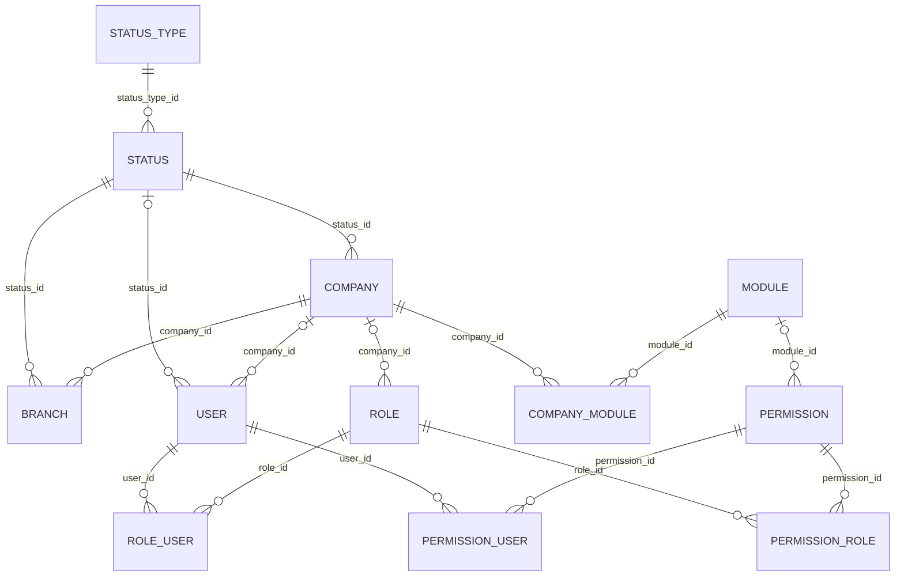

# Base de BUKO

## Decisiones iniciales

BUKO usa Laravel 12, PHP 8.2+, Blade, PostgreSQL 18, Tailwind 4 y JavaScript nativo. No hay SPA, Vue, React ni un archivo que cargue el comportamiento de todos los módulos. Los servicios son clases concretas para operaciones de negocio; los controladores se encargan de HTTP y los Form Requests de validación y autorización.

Un usuario operativo pertenece a una empresa. El superadministrador inicial tiene `company_id = null` e `is_super_admin = true`: configura el sistema y crea empresas. Un administrador de empresa es un usuario normal con un rol que concede los permisos correspondientes; no existe otro modelo de administrador ni un `is_admin` que omita la autorización.

Las tablas admiten roles globales con empresa nula, reservados a permisos de sistema. El alta inicial de usuarios en la interfaz crea cuentas de empresa; la gestión de operadores globales adicionales queda fuera de esta primera etapa.

## Instalar y abrir en Wamp

1. La base local `buko` ya existe. Se verificó la conexión a PostgreSQL 18.6 en `127.0.0.1:5433`, usuario `postgres`. Se utiliza esa base existente; revisa las credenciales de `.env` únicamente si cambias de entorno. No se han ejecutado migraciones ni cambiado la configuración del servidor.
2. Confirma `php --version` y `php --ri pdo_pgsql`. En este equipo PHP CLI y Apache son 8.2.26, con archivos diferentes: CLI usa `C:/wamp64/bin/php/php8.2.26/php.ini`; Apache usa `phpForApache.ini`. La extensión quedó verificada como activa en ambos entornos.
3. Si partes de otra copia del proyecto, ejecuta `composer install`, copia `.env.example` a `.env`, genera una clave con `php artisan key:generate`, ejecuta `npm ci` y `npm run build`. La copia actual ya tiene assets compilados.
4. Ejecuta tú las migraciones y catálogos:

```powershell
php artisan migrate
php artisan db:seed
```

5. Abre [BUKO en tu ruta actual de Wamp](http://localhost/buko/public/). Se utiliza la configuración existente de Wamp. No hace falta `php artisan serve` ni un servidor Vite durante la navegación normal.

Sesiones y caché usan archivos; las colas quedan síncronas al inicio. El login se puede mostrar antes de crear tablas. Autenticar o abrir módulos sí requiere migraciones y seeders.

## Acceso inicial local

En `.env` y `.env.example` se definieron valores de desarrollo:

- Correo: `admin@buko.local`
- Contraseña: `Buko.Local.2026!`
- Nombre: `Administrador BUKO`

El pie del login los muestra mediante un desplegable únicamente cuando `APP_ENV=local` y `BUKO_SHOW_LOCAL_CREDENTIALS=true`. El seeder solo crea la cuenta si no existe; repetirlo no cambia contraseñas ni eleva una cuenta existente. Si falta `BUKO_ADMIN_PASSWORD` o tiene menos de 12 caracteres, crea los catálogos y omite la cuenta con un aviso.

Antes de utilizar datos reales, cambia la credencial inicial y desactiva su visualización. La interfaz protege la edición del superadministrador y de los propios accesos; un flujo de perfil/cambio de contraseña se puede añadir después. Modificar la variable de entorno no cambia una cuenta ya creada.

## Empezar a administrar

1. Inicia sesión como superadministrador.
2. Crea una empresa con su estado y habilita `Organización` y `Usuarios y acceso`.
3. En Roles y permisos, elige la empresa y crea un rol llamado, por ejemplo, `Administrador de empresa`, con los permisos que deba administrar.
4. Crea un usuario para esa empresa y asígnale el rol. También puedes añadir permisos directos.
5. Sus sucursales, cuentas y roles quedan limitados a esa empresa. La configuración de empresas/módulos y los estados generales son del sistema.

La interfaz permite crear, listar, editar y eliminar de forma lógica empresas, sucursales, usuarios, roles, estados y menús. SoftDeletes conserva sus IDs y relaciones. El catálogo de módulos y permisos nace de código/seeder; no hay un editor que permita inventar una capacidad sin su implementación.

## Modelo de datos

Todas las relaciones de aplicación usan IDs con restricciones de clave foránea. Los `code` de tipos, módulos y permisos son valores funcionales del propio registro; ningún pivote ni entidad los utiliza como clave foránea. La tabla de tokens de recuperación incluida por Laravel sigue siendo almacenamiento del framework, sin modelo de dominio ni flujo de recuperación habilitado en esta base.



`status_types` contiene contextos estables (empresas, sucursales, usuarios y menús). `statuses` contiene nombres editables y `is_active`; puedes agregar estados sin modificar enums ni código. Un usuario o empresa con un estado inactivo no inicia ni conserva sesión. Cambiar el tipo de un estado existente se rechaza para no invalidar registros. El estado de sucursal describe su disponibilidad; todavía no existe asignación de usuarios ni operaciones por sucursal que deba bloquear.

La migración agrega `status_id` nullable a usuarios para no imponer valores ficticios a cuentas anteriores. El acceso falla de forma segura sin un estado activo. Las altas nuevas y el superadministrador del seeder siempre reciben un estado.

Los índices cubren listados por empresa, nombres únicos por empresa y ambos sentidos de los pivotes de permisos. Los roles globales tienen un índice único parcial para resolver la semántica de NULL.

## Reglas de autorización

| Control | Regla |
| --- | --- |
| Cuenta | Estado activo del usuario y, cuando corresponde, de su empresa |
| Configuración global | Permiso con `module_id` nulo; nunca autorizado a un usuario de empresa |
| Módulos de empresa | Presencia de `company_id` y `module_id` en `company_module` |
| Permisos operativos | Unión de permisos directos y permisos de roles de la misma empresa |
| Delegación | Solo permisos del ámbito correcto que el actor pueda conceder |
| Credenciales de otros | Una cuenta con permisos fuera del alcance del actor queda protegida |
| Relaciones ajenas | Rechazo de roles o IDs de otra empresa; un recurso ajeno devuelve 404 |
| Superadministrador | Acceso global explícito; su indicador no se acepta desde formularios |

Un permiso directo no sustituye la habilitación del módulo. Deshabilitar un módulo conserva las asignaciones, pero impide usarlas. No hay denegaciones individuales: los permisos son concesiones acumulativas. No se mueve una cuenta o rol entre empresas desde el formulario de edición.

En cada nueva función usa un permiso registrado, middleware/gate en la ruta y consultas limitadas a la empresa. No basta con ocultar un botón. Las relaciones de autorización se cargan de forma conjunta para no repetir consultas por enlace del menú.

## Organización de código

| Ruta | Responsabilidad |
| --- | --- |
| `app/Http/Controllers/Auth` | Login y cierre de sesión |
| `app/Http/Controllers/Management` | Controladores por recurso y coordinación HTTP |
| `app/Http/Requests/Management` | Validación, autorización y mensajes del módulo |
| `app/Services/Management` | Escrituras y transacciones de cada recurso |
| `app/Services/Access` | Aislamiento, comprobación y delegación de permisos |
| `app/Support/AsyncResponse.php` | Sobre JSON único para respuestas asíncronas |
| `app/Support/ListingResponse.php` | Vista completa o resultados Blade de búsquedas y paginación |
| `resources/views/layouts/partials` | Head, header, navbar, topbar y footer |
| `resources/views/components` | Campos, selects, estados, vacíos y acciones |
| `resources/views/modules/{modulo}` | Vistas y partials identificados por módulo |
| `resources/js/modules/{modulo}` | Entradas independientes cargadas por su vista |
| `resources/js/shared` | Fetch, formularios, modal y tema comunes |

Los formularios amplios de empresas, usuarios y roles tienen vista propia. Sucursales, estados y menús usan modal tanto para crear como para editar. Cada formulario completo está en un partial Blade de su módulo: Blade establece la acción, el método y los valores dentro de un `<template>` local. JavaScript solo clona ese HTML para abrir el modal; no consulta formularios ni hidrata campos desde JSON. La confirmación de borrado sigue la misma regla. Las rutas GET alternativas redirigen al listado para abrir su modal. El modal es `dialog` nativo: foco contenido, Escape, retorno al disparador y transiciones de entrada/salida. El servidor sigue autorizando y validando cada guardado.

Los estados se agrupan por `status_type_id` bajo el módulo/contexto al que se aplican: empresas, sucursales, usuarios y menús. No se añade una relación por texto ni se modifica el tipo al editar un estado.

Todos los listados disponen de buscador, filtros pertinentes, selector de filas, total y paginación visible incluso con una sola página o sin resultados. `ListingRequest` valida los parámetros y cada controlador conserva el ámbito de empresa al filtrar. Buscar, filtrar y paginar solicita por fetch únicamente los resultados Blade del listado; la dirección visible permanece limpia y no se modifica el historial. Los parámetros de los enlaces GET se utilizan como alternativa sin JavaScript, no se añaden a la barra del navegador durante el uso normal.

## Ciclo de vida e historial

La migración incremental `2026_10_24_055321_add_soft_deletes_and_audit_entries.php` agrega `deleted_at` a las seis entidades administrables y crea `audit_entries`. Debe ejecutarla el usuario mediante `php artisan migrate`; no modifica las cinco migraciones anteriores.

`lifecycle_status` expresa 1 activo, 0 inactivo y -1 eliminado. Es una lectura derivada de SoftDeletes y de `is_active`, sin duplicar la persistencia de estados ni sustituir `status_id`. Un rol no eliminado está activo. Los estados específicos de futuros flujos de facturas o nómina seguirán siendo estados de negocio separados de esta regla base.

Eliminar conserva pivotes e hijos. Una empresa eliminada deja de permitir acceso a sus usuarios; un rol eliminado deja de conceder permisos. Los estados utilizados, incluso por registros eliminados, no se pueden eliminar. Las restricciones para gestionar credenciales y permisos se aplican también al borrado. No hay borrado físico ni restauración desde el backoffice en esta etapa.

La auditoría guarda actor y ámbito mediante IDs, y un único registro de destino mediante claves foráneas explícitas: `company_record_id`, `branch_id`, `user_id`, `role_id`, `status_id` o `menu_item_id`. No emplea nombres o códigos como relaciones. Los cambios contienen valores antes/después de campos permitidos y asignaciones por ID; no contienen contraseñas, hashes ni tokens. El cambio de contraseña solo deja un indicador seguro.

Escritura e historial forman una transacción: si falla la auditoría no se confirma la modificación. Cada edición muestra los últimos cinco eventos y enlaza al historial completo con búsqueda por actor, filtro de acción y paginación mediante fetch. Las rutas de historial tienen un catálogo cerrado y comprueban permisos y empresa, incluso al consultar registros eliminados. Los registros anteriores comienzan sin eventos; no se crea una cronología ficticia.

## Contrato fetch

```json
{
  "success": true,
  "message": "Cambios guardados correctamente.",
  "data": { "redirect": "http://localhost/buko/public/empresas" },
  "errors": {},
  "meta": {}
}
```

El mismo sobre se utiliza para fallos, con `success=false` y el código HTTP correspondiente. Los errores por campo están en `errors`, por ejemplo `{"email":["Escribe un correo válido."]}`. Se normalizan autenticación, autorización, sesión expirada, validación, límite de intentos y errores inesperados; estos últimos no exponen detalles internos.

`shared/http.js` envía Accept JSON, CSRF y credenciales del mismo origen. `shared/forms.js` distingue rechazo del servidor y fallo de red, conserva los datos, evita dobles envíos, muestra errores por campo y dirige el foco al primer error. Validación inicial en blur; el servidor siempre valida nuevamente. El frontend no hace consultas de existencia de usuarios al escribir el correo.

Cada módulo tiene entrada Vite independiente. Vite puede extraer un chunk común para formularios y transporte, pero ninguna entrada importa todos los módulos. `app.js` contiene solo shell y tema. Después de cambiar JS/CSS ejecuta `npm run build` para Wamp.

La navegación entre módulos y formularios amplios utiliza enlaces normales de Laravel y documentos Blade completos. No hay router de JavaScript, importación dinámica de módulos ni animaciones que demoren la navegación. Cada vista declara su entrada con `@section('module', ...)` cuando la necesita y el layout la incluye directamente con Vite.

El navegador gestiona Atrás/Adelante, visitas directas y Ctrl/Cmd+clic. Fetch queda limitado a operaciones de formulario y resultados de listados. El HTML de resultados procede exclusivamente de partials Blade propios; los textos y atributos variables se escapan con `{{ }}`. No se construyen formularios concatenando datos en JavaScript ni se acepta HTML libre de registros.

## Diseño y tipografía

Dirección: interfaz empresarial serena, variación 4/10, movimiento 3/10 y densidad 4/10. La pantalla inicial es el login. La composición abstracta utiliza CSS y la paleta proporcionada; no contiene fotografías ni copy promocional. No se ha instalado Carbon ni se presenta el resultado como un componente oficial de ese sistema.

La referencia de estructura fue el [patrón de login de Carbon](https://www.carbondesignsystem.com/building-blocks/core/patterns/login). Se mantiene el acceso directo con correo y contraseña, sin introducir un flujo progresivo de SSO que la aplicación todavía no necesita.

| Fuente | Criterio |
| --- | --- |
| [IBM Plex Sans](https://github.com/IBM/plex) | Elegida y autoalojada; carácter empresarial y jerarquía clara |
| [Source Sans 3](https://github.com/adobe-fonts/source-sans) | Alternativa si se quiere una apariencia más neutral en formularios densos |
| [Geist](https://github.com/vercel/geist-font) | Alternativa si se busca una dirección más cercana a un producto SaaS |

Solo IBM Plex Sans está instalada, en pesos 400/500/600. Los archivos WOFF/WOFF2 se sirven desde los assets compilados; no hay llamadas a Google Fonts ni CDN en ejecución. La licencia OFL se conserva en `public/licenses/IBM-Plex-Sans-OFL.txt`.

Tokens centralizados en `app.css`, con superficies claras/oscuras, foco visible y preferencia de tema persistida localmente. La estructura de la aplicación y las ventanas se mantienen en `resources/css/components/workspace.css`. Emil Kowalski es el criterio principal de motion y Jakub Krehel el secundario: feedback de 160ms, entrada de modales de 230-260ms y salida de 130-180ms. Los desplegables del sidebar y los modales tienen transiciones discretas; la navegación no espera ni aplica un fade a toda la página. Sin bucles ni demoras de teclado. Movimiento reducido desactiva las animaciones de Web Animations API y las transiciones CSS.

Los iconos son SVG estáticos oficiales de Tabler, servidos e insertados localmente mediante el componente Blade `icon`. No se añadió ningún paquete. La licencia se conserva en `public/licenses/Tabler-Icons-MIT.txt`. Las acciones de icono tienen nombres accesibles y ayuda visible mediante title.

## Menú administrable

Se añadió exclusivamente la migración incremental `2026_10_24_044935_create_menu_items_table.php`. Las migraciones anteriores son inmutables. Sobre la base existente basta ejecutar manualmente:

```powershell
php artisan migrate
```

No es necesario volver a ejecutar el seeder: la migración incorpora el tipo de estado de menús, sus dos estados iniciales, el permiso global de administración y la navegación inicial sin sobrescribir los catálogos ya existentes. Antes de aplicarla, una navegación de respaldo conserva el acceso a la aplicación y la pantalla Menús muestra que está pendiente.

`menu_items` almacena `name`, `is_parent`, `icon`, `route_name`, `sort_order` y las relaciones `parent_id`, `module_id`, `permission_id`, `status_id`, todas con claves foráneas a IDs. Un menú padre agrupa opciones y no ejecuta ninguna acción. Una hoja pertenece a un padre y selecciona una acción GET registrada en `NavigationRegistry`, que muestra el controlador y su método. Permiso y módulo se derivan en servidor y se guardan por ID; nunca se evalúa texto PHP procedente de la base.

La navegación tiene dos niveles y valida autorreferencias, padres válidos y acciones permitidas. Un padre con hijos no se puede eliminar ni convertir en hoja hasta mover o eliminar sus hijos. Eliminar una entrada solo cambia la navegación; no borra el código, permisos ni datos del módulo. Para una nueva función programada, registra su ruta inicial en el catálogo y luego administra su ubicación desde backoffice.

El sidebar oculta entradas inactivas, módulos no habilitados y permisos no concedidos. Los padres sin hijos visibles se omiten. Las rutas mantienen su autorización aunque se manipule la configuración de un menú. En escritorio se puede contraer a iconos; en móvil es un panel con fondo, foco contenido, cierre por Escape y el contenido de fondo inerte.

La suite UI/UX se aplicó a estructura, tablas, formularios y grid. La skill de gráficos se revisó y quedó documentada en AGENTS: no se introdujeron gráficos ni cifras de ejemplo porque aún no hay métricas operativas que los justifiquen. Las cifras de Inicio provienen de conteos reales y solo aparecen con permiso.

## Verificación y límites

- La suite automática PHP usa SQLite en memoria, configurada con `APP_URL=http://localhost` para no heredar el prefijo de Wamp. Nunca usa ni migra `buko`.
- Rutas y compilación de Blade verificadas; build de producción de Vite ejecutado.
- Login real completado en Wamp contra PostgreSQL después de las migraciones y seeders ejecutados por el usuario. Además, `tests/Manual/PostgresNavigationSmokeTest.php` comprueba CRUD HTTP de menús y aislamiento por empresa contra la conexión PostgreSQL local existente, con transacciones revertidas. No migra ni ejecuta seeders y no deja registros de prueba. Esta comprobación manual está fuera de las suites automáticas.
- La incorporación de borrado lógico e historial se verificó en SQLite en memoria. La nueva comprobación PostgreSQL requiere que el usuario aplique primero `2026_10_24_055321_add_soft_deletes_and_audit_entries.php`; no se ha ejecutado ni migrado la base local para este cambio. Las capturas de historial proceden de vistas Blade reales renderizadas con fixtures aislados.
- Se comprueba el layout móvil mediante un viewport de 390 × 844 que muestra la propia aplicación, sin herramientas nuevas. No sustituye una sesión en dispositivos físicos ni una medición Lighthouse; esas dos comprobaciones no se presentan como realizadas.
- El seeder se puede repetir. No restaura contraseñas ni sobrescribe estados editados.

```powershell
php vendor/phpunit/phpunit/phpunit
php vendor/bin/pint app/Http app/Models app/Providers app/Services app/Support config/buko.php database/seeders routes tests/Feature tests/Manual lang
npm run build
```

Comprobación manual opcional de la conexión PostgreSQL ya preparada, sin migrar y revirtiendo los datos de prueba:

```powershell
php vendor/phpunit/phpunit/phpunit --no-configuration --bootstrap vendor/autoload.php tests/Manual/PostgresNavigationSmokeTest.php
```

## Siguientes decisiones propuestas

1. **Ampliar la auditoría antes de nómina**: la base administrativa ya registra sus cambios. Definir retención y alcance para futuras operaciones de nómina, sin registrar valores sensibles innecesarios.
2. **Acceso por sucursal**: confirmar si un usuario opera en todas las sucursales de su empresa o en un subconjunto. No se ha agregado un pivote sin conocer esa regla.
3. **Perfil, recuperación y MFA**: definir correo saliente y segundo factor antes de exponer BUKO a Internet. El login actual no muestra enlaces a flujos que no existen.
4. **Permisos más finos**: la base usa `manage` por módulo. Separar lectura/creación/edición/exportación cuando aparezca una necesidad real.
5. **Empresa y entidad legal**: decidir si empresa equivale a razón social para nómina, y si las sucursales comparten identificación fiscal.

## Configuración global de procesos

Sistema → Procesos administra `process_steps` y el catálogo `process_stages` desde formularios modales Blade. Cada paso almacena `origin_stage_id`, `destination_stage_id`, `status_id` y `responsible_role_id` con FKs restrictivas. Las etapas tienen nombre único y `status_id` propio. Los contextos de estados son `processes` y `process_stages`; no se reutilizan estados de otros módulos. El módulo Compras interpreta sus transiciones para ejecutar el flujo operativo descrito a continuación. No hay asignación automática de cuentas desde el CRUD global.

El permiso global `system.processes.manage` no tiene asignaciones iniciales: accede el superadministrador, con delegación posterior explícita a cuentas globales. Ser rol responsable no concede permisos ni acceso. La selección muestra roles existentes con su empresa o ámbito global, excluyendo roles y empresas eliminados. Los registros son configuración global, no se acepta un ámbito empresarial desde el formulario.

La migración incremental del 26/10/2026 incorpora tablas, catálogos, permiso, menú bajo Sistema y FKs `process_stage_id`/`process_step_id` en auditoría. Los cambios y el borrado lógico se auditan en la misma transacción; el historial permanece consultable tras eliminar. Las etapas referenciadas incluso por pasos eliminados y los estados utilizados no admiten eliminación. Las migraciones locales las aplica el responsable del entorno.

## Compras: solicitudes por etapa y tracking personal

`purchase_stages` vincula empresa, etapa del catálogo, rol responsable y estatus inicial/de resultado mediante FKs. `field_name` selecciona el manejador de formulario (los cuatro campos de fecha); es una clave técnica, no un estatus de negocio. Las posiciones definen la secuencia esperada; cada avance también exige una única transición activa coincidente en `process_steps`. Una configuración incompleta se rechaza sin guardar datos parciales.

`purchase_requests` contiene proveedor por ID, monto decimal, USD, cuatro fechas manuales, etapa actual, estatus dinámico, autor, versión y fecha de finalización. Los estados de negocio pertenecen al contexto `purchase_requests`; nunca sustituyen la disponibilidad Activo/Inactivo de los catálogos. Los proveedores pertenecen a una empresa y tienen catálogo de estados propio. Todas las entidades administrables nuevas tienen borrado lógico y auditoría con FKs; no se ofrece eliminación de solicitudes porque este alcance excluye cancelaciones.

El acceso operativo exige módulo Compras habilitado, permiso `purchases.requests.work`, pertenencia a empresa y rol vigente de la etapa. La actualización bloquea la solicitud, verifica su versión y vuelve a comprobar el acceso. El servidor deriva empresa, autor, etapa, estatus y moneda; los campos de otras etapas se rechazan. La finalización de Pago cierra la solicitud. El tracking filtra `audit_entries.actor_id` por el usuario concreto y conserva consulta al avanzar; no amplía el ámbito a otros usuarios del mismo rol. Formulario e historial comparten autorización. Las fechas se normalizan a valores escalares en auditoría; contraseñas nunca se registran.

La preparación inicial es un comando local explícito, transaccional y repetible: no es un seeder ni parte automática de una migración. Conserva credenciales existentes y rechaza colisiones de cuentas, permisos y configuraciones. Los roles de compra solo reciben el permiso operativo, sin administración de usuarios, proveedores o Procesos. El superadministrador administra el catálogo de proveedores. El proveedor solicitado y las cuatro cuentas se crean únicamente al ejecutar la preparación autorizada.

### Verificación del flujo de compras (26/10/2026)

- Suite SQLite en memoria: 134 pruebas, 1266 aserciones, todas aprobadas; Pint y build correctos. Tras el ajuste final de accesos de Inicio/navegación se volvieron a verificar Compras y navegación: 24 pruebas aprobadas.
- Migración de Compras aplicada explícitamente en PostgreSQL local y preparación autorizada de Yraida Guillén completada (cuatro cuentas, cuatro etapas, tres transiciones y proveedor inicial).
- Comprobación real de PostgreSQL: avance completo hasta Pago, pendientes, tracking y cuatro eventos de auditoría en una transacción revertida, sin solicitudes ni auditorías de prueba persistidas.
- Navegador: login del comprador, menú restringido, pendientes vacíos con paginación, formulario con proveedor inicial, errores por campo y foco al enviar sin datos, navegación Atrás/Adelante. La URL configurada de esta instalación es `http://localhost/adicora/public`; la ruta histórica `/buko/public/` devolvió 404. No se cambió Wamp, Apache ni APP_URL.
- La comprobación visual móvil y las sesiones de los otros tres roles no se ejecutaron en navegador; sus permisos y etapas sí se cubrieron en las pruebas automáticas y el recorrido transaccional de PostgreSQL.

## Editor de procesos nombrados

`process_definitions` identifica el proceso por nombre, empresa y estado administrativo. Una FK enlaza las etapas operativas y las transiciones existentes; la migración incremental del editor agrupa los registros de cada empresa bajo Compras sin cambiar sus IDs ni inventar eventos históricos. Los índices únicos parciales de etapas vigentes conservan posiciones y campos de filas eliminadas sin bloquear inserciones futuras.

La pantalla mantiene el nombre sobre la tabla de origen/destino/rol/resultado de negocio. Cada fila corresponde a una etapa operativa, incluida la terminal; el destino se deriva de la siguiente posición. Los modales locales permiten insertar, cambiar o quitar filas. `ProcessConfigurationService` bloquea la definición, comprueba versión y ausencia de solicitudes en curso, reordena posiciones y sincroniza las transiciones en la misma transacción, con auditoría de cada fila y de la secuencia. No hay edición independiente de conexiones que pueda divergir de la configuración operativa. El catálogo global de etapas conserva su función de nombres y disponibilidad.

La creación y el avance de compras bloquean la misma definición para evitar carreras con el editor. Las revisiones pueden carecer de campo de fecha y permiten completar la etapa sin inventar datos. El motor sigue la secuencia configurada y finaliza al llegar a la última etapa; las validaciones de fecha comparan con la fecha previa de la secuencia vigente. El primer paso conserva la captura de proveedor/monto/fecha de compra. El tracking continúa delimitado por actor y empresa. El editor es configuración global y conserva `system.processes.manage`; no concede ese acceso a los responsables operativos.

### Verificación del editor de procesos

Migración de agrupación aplicada con autorización expresa. Suite completa: 135 pruebas y 1259 aserciones aprobadas en SQLite en memoria; Pint y build correctos. PostgreSQL: inserción de una revisión, reordenación, conexiones, retirada de etapa y auditoría comprobadas en transacción revertida, además del recorrido completo del flujo de compras. No se conservaron fixtures ni auditorías de esas pruebas.

Navegador con sesión de superadministrador: tabla ordenada con nombre del proceso, rol, resultado y fin explícito; modales locales de alta/edición/confirmación; Escape; búsqueda por rol mediante fetch sin cambiar URL ni destino de la fila filtrada. Se ajustó la anchura para leer los estatus completos y se retiró el espacio reservado por mensajes vacíos. La revisión visual de móvil no se ejecutó; el scroll horizontal permanece limitado a la tabla y los controles usan los componentes adaptables existentes.
